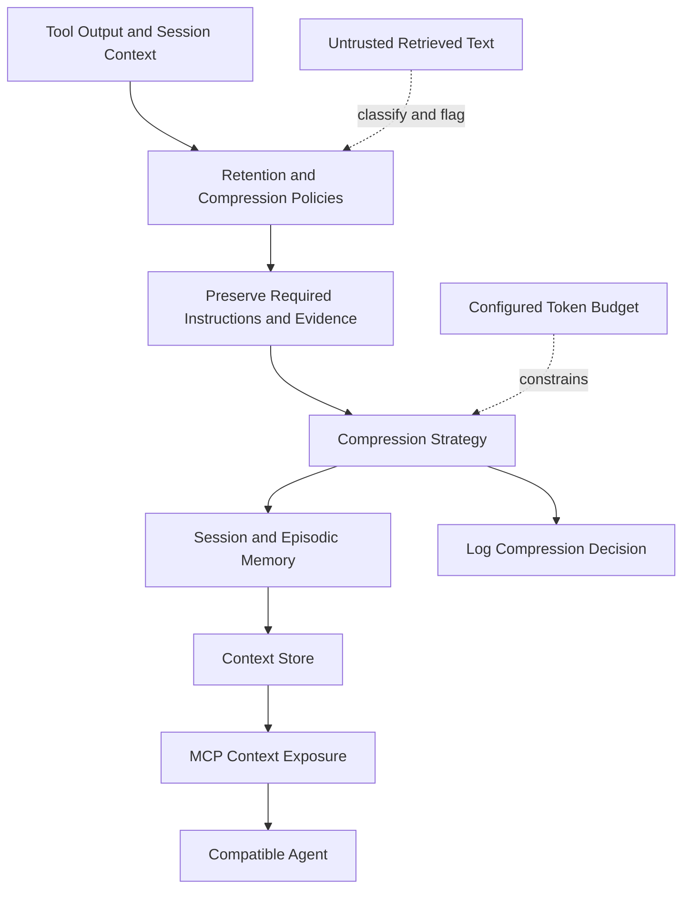
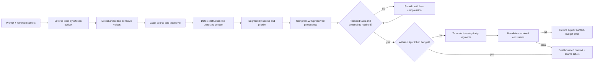

# x4-context

**Context compression and persistent session memory for AI agents.**

Sandboxed tool output, aggressive context reduction patterns, multi-platform routing via MCP. Designed to keep agents aware across long sessions without burning tokens.

Part of the X4 / ARIEX4Ops ecosystem.

## Goals

- Reduce context window pressure by 90%+ on tool-heavy workflows
- Persist session memory across runs
- Route compressed context via MCP to any compatible agent
- Evidence-backed: every compression decision is logged

<!-- X4-APEX-DIAGRAM-START:x4-context -->



<!-- X4-APEX-DIAGRAM-END:x4-context -->

## Quick Start

```bash
pip install -e ".[dev]"
python -m x4_context.demo
```

## Structure

```
x4-context/
├── src/x4_context/
│   ├── compress.py      # core compression strategies
│   ├── memory.py        # session + episodic store
│   ├── mcp_server.py    # MCP exposure
│   └── policies.py      # what can be dropped vs kept
├── tests/
└── .github/workflows/ci.yml
```

## License

Apache-2.0

## APEX Architecture Map

> Status: architecture documentation; implementation and deployment claims require independent verification.


**Evidence note:** Token counting, redaction, provenance, and injection handling must be tested against adversarial fixtures; compression must not silently discard mandatory constraints.

